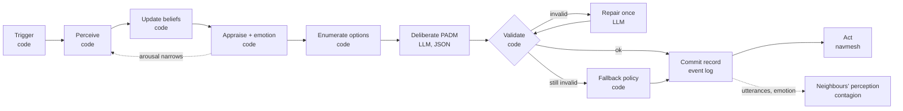
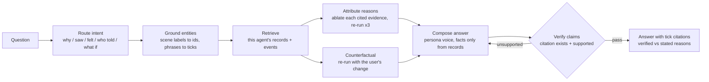

# Occupant cognition, decision logging and interviews (design)

Status: design for WS-C, 2026-11-07. Citations marked [verify] are being
checked; see the Sources section.

## The problem with "log the decision, explain it later"

Asking a model afterwards why it did something produces a plausible story, not
the cause. Chain-of-thought explanations are often unfaithful to what actually
drove the output (Turpin et al. 2023), and people do the same thing when asked
about their own choices (Nisbett and Wilson 1977). So the interview cannot be
"here is the action, now explain it". Three rules follow:

1. Record state and reasons at decision time, never reconstruct them later.
2. Compute what research has numbers for in code (perception, trust, appraisal,
   emotion, contagion, timing); use the LLM only for judgment under ambiguity.
3. Test reasons by intervention: re-run the same decision with one piece of
   evidence removed. A reason is "verified" only if removing it changes the choice.

## Pipeline (one decision, one occupant)



| Stage | Who | What it does | Grounding |
|---|---|---|---|
| 0 Trigger | code | Decision points: cue onset (alarm, smoke, PA, shout), fork reached, path blocked, someone needs help, periodic re-appraisal every 20 s | PADM: decisions are cue-driven (Lindell and Perry 2012) |
| 1 Perceive | code | Builds a Percept: what this occupant can see (isovist on the walkable area: exits, signs, smoke, people and what they do) and hear (alarm, PA, utterances within earshot). Attention budget shrinks as arousal rises | Easterbrook 1959 cue-utilization: high arousal narrows attention [verify]; static exit signs noticed by ~38% (Xie 2012, in research/MAPPING_IDEAS.md) |
| 2 Beliefs | code | Beliefs carry value, confidence, source and tick. Source credibility weights: own observation > official PA > warden/staff > known person > stranger. Direct observation overrides hearsay | Trust in warning sources (Lindell and Perry 2012, stakeholder perceptions); rumor handling for the adversary |
| 3 Appraise + emotion | code | Appraisal variables: relevance, threat certainty, urgency, coping potential, goal blocked, social proof (fraction of neighbours evacuating), responsibility (role, dependants). Emotions computed from appraisals: fear, anxiety, frustration, hope/relief, concern for others; plus valence and arousal. Decay to a personality baseline; contagion from neighbours | Appraisal theory (Lazarus 1991; Scherer component process model) [verify]; OCC model for computational emotions (Ortony, Clore, Collins 1988); ASCRIBE emotion contagion (Bosse et al.) [verify]; OCEAN-to-crowd parameters (Durupinar et al. 2016) [verify] |
| 4 Options | code | Closed set of feasible actions with features: EVACUATE(exit, route length, est. queue), FOLLOW(person), SEEK_INFO(person or place), HELP(person), GATHER(person or item), CONTINUE_TASK, HIDE(room) for intruder, SHELTER for hazmat, TURN_BACK. Only exits this occupant knows (entry route, seen, signed, told) | Familiar-exit bias and affiliation (Sime 1985); milling and information seeking (Wood, Mileti) [verify] |
| 5 Deliberate | LLM | One structured call: persona (archetype + OCEAN + role) + percept + beliefs + appraisal/emotion + options. Output walks the five PADM questions and must cite evidence ids | PADM protective-action questions (Lindell and Perry 2012) |
| 6 Validate | code | Option id is offered; every cited evidence id exists and was available to this occupant; PADM answers consistent with the choice; utterance passes a content filter. One repair try, then a deterministic persona fallback | "Model proposes, code checks" |
| 7 Commit | code | Append an immutable DecisionRecord to the event log (JSONL). The log is the single source of truth for replay, interviews and metrics | Event sourcing; flight-recorder principle |
| 8 Act | code | Navmesh steering; timing gates (notice latency sampled per persona, lognormal) | Pre-movement distributions (Lovreglio et al. 2019 database) |

Why emotions are computed, not asked for: an LLM asked "how do you feel" is
inconsistent and too calm (research/SCENARIOS_AND_MODELS.md: the anxious persona
froze in 22 of 24 cornered calls vs 34% in real footage). Computing emotion from
appraisals makes it reproducible, tunable to data, and explainable ("fear 0.8:
smoke visible, nearest known exit blocked"). The LLM also returns a one-word
self-report; we log both and report how often they agree.

The feedback loop is the interesting science: arousal narrows perception, fewer
cues lower coping potential, which raises fear, which spreads to neighbours.
Each link is a published effect and each is a separate, testable function.

## Deliberation output (what the LLM must return)

```json
{
  "padm": {
    "threat_real": "yes|no|unsure", "threat_evidence": ["p3", "b2"],
    "need_action": "yes|no|later",  "need_evidence": ["p3"],
    "options_considered": ["o1", "o4"],
    "choice": "o4", "why": "Smoke at the main hall; the side exit sign is lit.",
    "choice_evidence": ["p3", "p7"],
    "when": "now|after_task|after_info"
  },
  "say": "Side exit, follow me",
  "feel": "afraid", "confidence": 0.7
}
```

Evidence ids (`p*` percepts, `b*` beliefs, `m*` messages, `o*` options) are
handed to the model in the prompt, so every reason is a pointer the validator
can check, not free text.

## DecisionRecord (one line of the event log)

```json
{
  "record_id": "d_000184", "run_id": "run_42", "tick": 312, "t_s": 78.0,
  "agent_id": "a_17", "persona": "first_time_visitor", "model": "google/gemini-2.5-flash-lite",
  "trigger": {"kind": "fork_reached", "ref": "node_33"},
  "percepts": [{"id": "p3", "kind": "smoke", "where": "r_lobby", "dist_m": 6.2, "channel": "sight"},
               {"id": "p7", "kind": "exit_sign", "ref": "e_2", "lit": true, "dist_m": 9.0}],
  "beliefs_before": [{"id": "b2", "key": "exit_open:e_1", "value": false, "conf": 0.6,
                      "source": {"kind": "utterance", "ref": "m_88", "from": "a_09"}, "tick": 290}],
  "beliefs_after": "...",
  "appraisal": {"relevance": 0.9, "certainty": 0.8, "urgency": 0.7, "coping": 0.4,
                "goal_blocked": 0.3, "social_proof": 0.5, "responsibility": 0.0},
  "emotion": {"fear": 0.72, "anxiety": 0.31, "frustration": 0.22, "hope": 0.35,
              "concern": 0.05, "valence": -0.58, "arousal": 0.81},
  "emotion_sources": [{"emotion": "fear", "from": "appraisal", "delta": 0.5},
                      {"emotion": "fear", "from": "contagion", "agent": "a_09", "delta": 0.12}],
  "options": [{"id": "o1", "action": "EVACUATE", "exit": "e_1", "route_m": 14.0, "queue_s": 20},
              {"id": "o4", "action": "EVACUATE", "exit": "e_2", "route_m": 22.0, "queue_s": 0}],
  "prompt_sha256": "...", "raw_output": "...", "decision": {"...": "PADM block above"},
  "validation": {"status": "ok|repaired|fallback", "errors": []},
  "latency_ms": 612, "cost_usd": 0.00011
}
```

Between decisions the log also records episodic events (saw, heard, said,
arrived, blocked, helped), so the interview can answer "what happened" as well
as "why".

## Interview pipeline (agentic, grounded, checked)



- Retrieval is structured (filter by agent, tick window, entity id), not
  embedding search, so it is deterministic and complete.
- Reason attribution: for the decision in question, remove each cited evidence
  item in turn and re-run the recorded prompt three times. Items whose removal
  flips the majority choice are "verified reasons"; the rest are "stated, not
  decisive". This turns the model's own stated reasons into a measurable,
  checkable explanation.
- Counterfactuals ("would you have gone left if the sign were lit?") are real
  re-runs of the recorded decision with that change, reported as a distribution.
- Verification: every sentence must cite a record or event; a cheap judge model
  checks that each cited record supports the sentence; unsupported sentences
  are dropped. The UI shows a grounding badge.

Example answer: "I went to the side exit at 78 s because I saw smoke in the
lobby [t=312, p3] and the side exit sign was lit [p7]. Removing the smoke from
my view changes my choice in 3 of 3 re-runs; removing the sign changes it in 1
of 3. Earlier, a man told me the main door was locked [m_88 from a_09]."

## What this gives us to measure (and show)

- Calibration against the literature: pre-movement time distribution, familiar
  exit share, freeze and hide rates per scenario (research/EVAC_PSYCHOLOGY.md).
- Explanation faithfulness rate: share of stated reasons that are decisive
  under ablation, per model and persona. Novel, cheap, and a direct answer to
  "how do you know the agents are not just making things up".
- Influence graph: who changed whose beliefs and emotions (rumor spread tree,
  contagion paths), straight from `source` and `emotion_sources` fields.
- Agreement between computed emotion and self-reported feeling.

## Cost and latency

Per decision: one LLM call (deliberation); everything else is code. A repair
or fallback is rare and logged. Interviews: 1 to 2 calls, plus ablation re-runs
only for the clicked occupant (about 3 x number of cited items, cached). With
gemini-2.5-flash-lite this stays within research/LLM_LATENCY.md budgets.

## Sources

Verified so far are listed in research/EVAC_PSYCHOLOGY.md and
research/SCENARIOS_AND_MODELS.md. Items marked [verify] above are being checked
(full citation, what the paper actually shows, usable parameters) and will be
added here.
